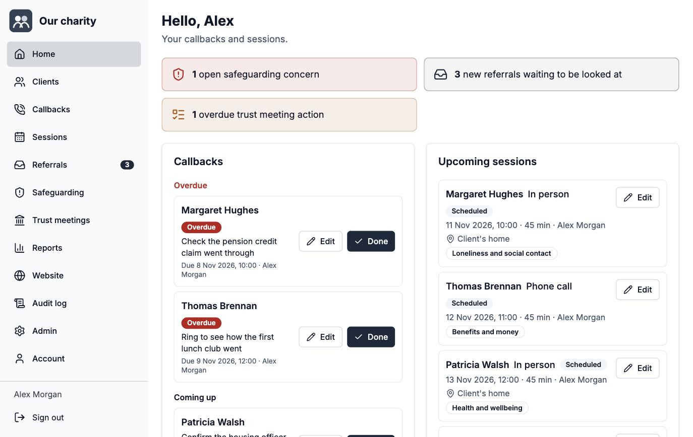
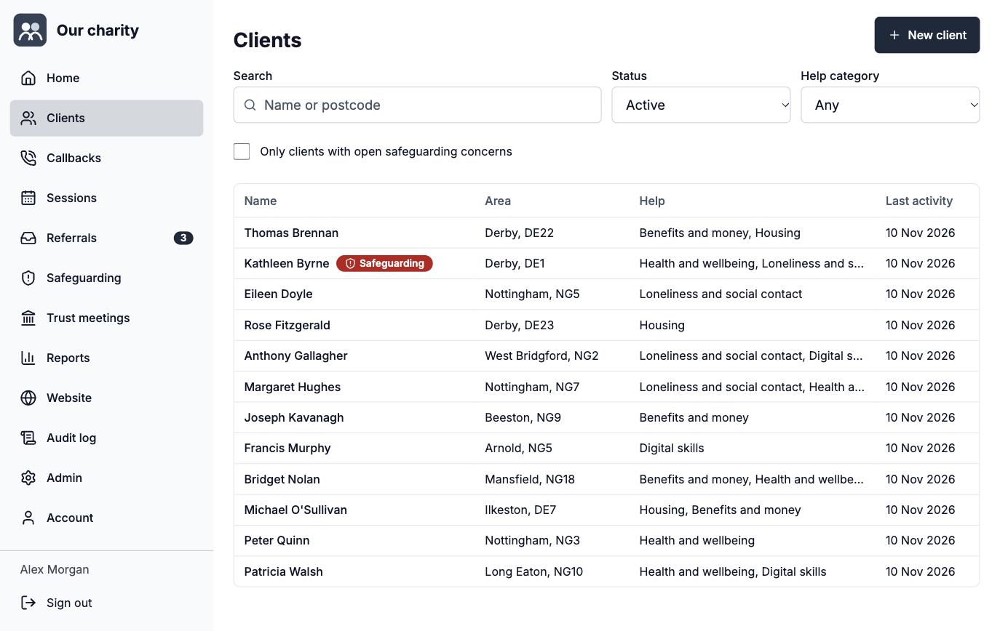
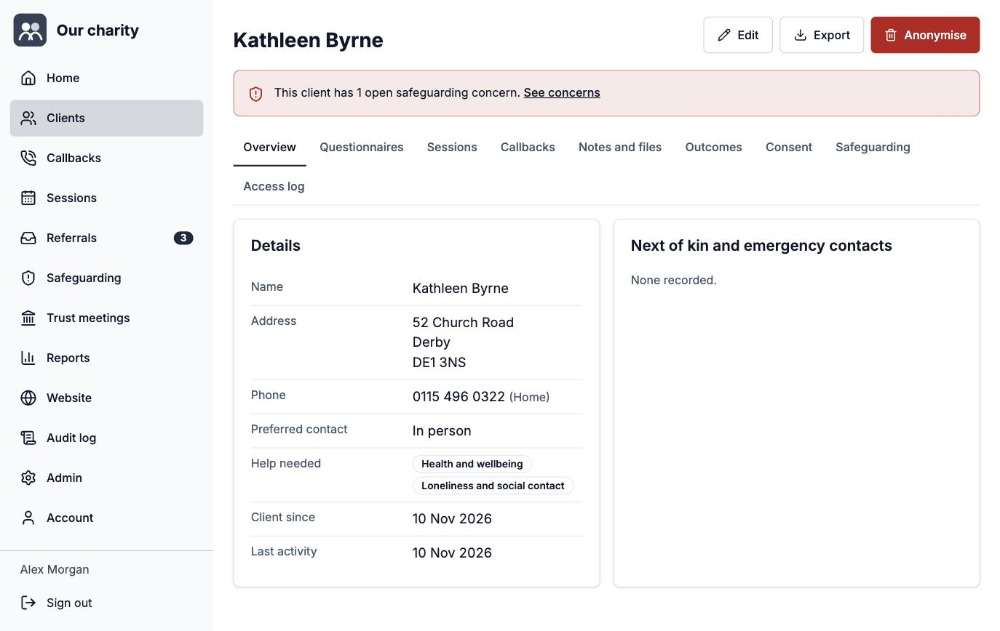
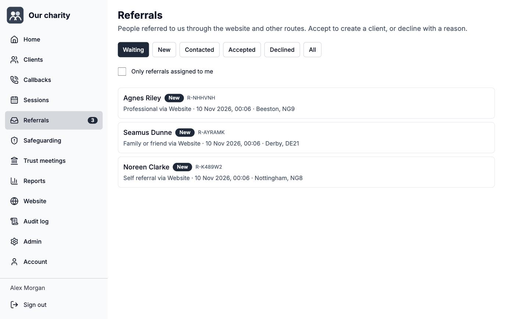
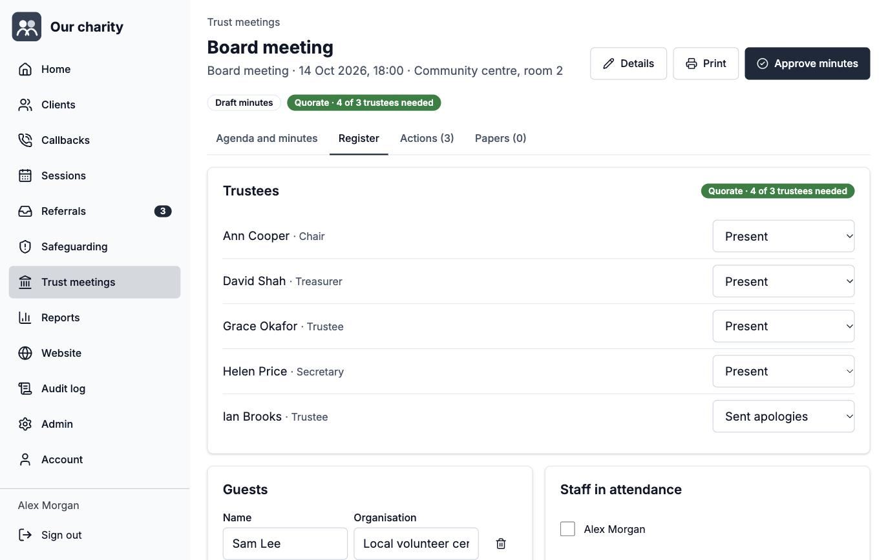
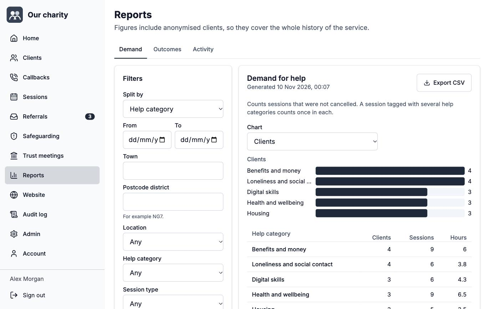
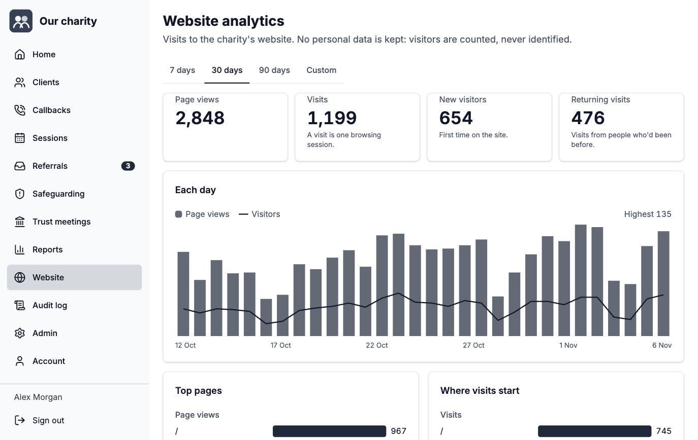

# Charity Contact Management

An open source client and case management system for small charities. It records the people a charity helps, the help given and the outcomes achieved, and reports on impact by place and type of help. It's built to be secure, fully audited and cheap to run on Firebase.

The first deployment is for Nottingham & Derby Irish Elder Support (NDIE).

## Screenshots

These show the default theme with made-up demo data. A charity can change the name, colours, fonts and logo.

| | |
| --- | --- |
|  **Home**: each person's callbacks and sessions, with alerts for safeguarding, new referrals and overdue actions. |  **Clients**: search by name or postcode, filter by status and type of help. |
|  **Client record**: details, questionnaires, sessions, callbacks, notes, outcomes, consent, safeguarding and who has looked at the record. |  **Referrals**: referrals from the website wait here until someone accepts or declines them. |
|  **Trust meetings**: agenda and minutes, the register with a quorum check, actions and papers. |  **Reports**: demand, outcomes and activity, split by place, type of help, session type, staff member or month. |
|  **Website analytics**: visits, pages, sources and campaigns, with no personal data kept. | |

## What it does

- **Clients**: core details, next of kin and emergency contacts, and questionnaires that each charity builds for itself from reusable questions. Health and finance sets can be marked sensitive.
- **Sessions, callbacks and notes**: appointments and calls, with in-person locations from a managed list. Scheduled follow-ups with reminders, ad hoc notes and file attachments.
- **Outcomes and reports**: outcome measures from the client's and the staff view, split by town, postcode district, location, help category, session type, staff member or month. Reports export to CSV.
- **Referrals**: a public form on the charity's website sends referrals here through a server to server key, with bot protection and rate limits. Staff triage them, then accept (creating or linking a client) or decline. See [docs/referrals.md](docs/referrals.md).
- **Safeguarding**: concerns with severity, status, a lead and a full history. Clients with open concerns are flagged to people allowed to see them.
- **Consent and GDPR**: consent records per purpose, restrictions when consent is withdrawn, subject access export and right to erasure.
- **Trust meetings**: trustees, agendas, minutes, a register with a quorum check, actions that carry forward until they're done, meeting papers and a printable copy for signing. See [docs/meetings.md](docs/meetings.md).
- **Retention**: a daily job anonymises clients after a configurable period of inactivity. It keeps what's needed for impact reporting and nothing that identifies the person.
- **Audit**: every read and every change is logged with who, what, when and whether it came from the web app or from Claude.
- **Claude**: a built in MCP server lets staff use Claude with the system, with exactly their own permissions and the same auditing.
- **Google Calendar**: sessions and callbacks can appear in each person's own calendar.
- **Website analytics**: page views, visits, new and returning visitors, top pages, sources and UTM campaigns from the charity's website, with no IP addresses stored. See [docs/analytics.md](docs/analytics.md).
- **Theming**: one short file sets your name, colours, fonts, corners and logo, and a check tells you if any text would be hard to read. The default is neutral.

It works on a phone. Staff can sign in and do everything from a mobile.

## How it's built

TypeScript throughout. React with shadcn/ui style components on the front end, and Firebase Authentication, Firestore, Cloud Storage and Cloud Functions behind it.

```
packages/shared   The API contract: operations, input schemas, types and permissions
functions         Cloud Functions: the api callable, MCP server, scheduled jobs, calendar sync
web               The React app
config/seed       Starting configuration (default and NDIE)
scripts           Seed script
docs              Architecture, deployment and MCP guides
```

The key design decision is that browsers never read or write Firestore or Storage directly. The security rules deny everything, and all access goes through one server side dispatcher that checks permissions and writes the audit log. That's what makes "every read is audited" enforceable rather than a convention. [docs/architecture.md](docs/architecture.md) explains it in more detail.

## Putting it live

The easiest way needs nothing installed. Click the button, sign in with your charity's Google account and follow the steps:

[](https://shell.cloud.google.com/cloudshell/open?cloudshell_git_repo=https://github.com/DominicFinn/finncms-charity&cloudshell_tutorial=docs/cloudshell-tutorial.md)

Or, on your own computer with Node 24, git and the Google Cloud CLI:

```sh
curl -fsSL https://raw.githubusercontent.com/DominicFinn/finncms-charity/main/install.sh | bash
```

Either way you answer three questions: a Firebase project id, your charity's name and the first administrator's email. Setup creates the project if needed, deploys everything and lists the few steps Google only allows in the console. [docs/deploy.md](docs/deploy.md) covers it in full, including updating and troubleshooting.

## Making it your own

Your name, colours, fonts, logo and starting lists all go in one `site/` folder, so updates to the shared code never touch them. Start with `npm run site:init -- --name "Your Charity"` and follow [docs/customise.md](docs/customise.md). No coding needed.

## Running it locally

You need Node 24 or later and Java 21 or later (for the Firebase emulators). The Firebase CLI comes with the project.

```sh
npm install
cp web/.env.example web/.env.development.local   # set VITE_USE_EMULATORS=true. Only `npm run dev` reads this name, so it never leaks into a deploy build
printf 'BOOTSTRAP_SUPERUSER_EMAIL=you@example.org\nAPP_URL=http://localhost:5173\n' > functions/.env.local
printf 'GOOGLE_OAUTH_CLIENT_SECRET=unused\n' > functions/.secret.local
npm run build -w functions
npx firebase emulators:start --project demo-ccm   # in one terminal
npm run seed -- --config ndie                      # in another, once the emulators are up
npm run dev                                        # the web app on http://localhost:5173
```

Sign in with the emulator's Google popup using the email you set as `BOOTSTRAP_SUPERUSER_EMAIL`. That account becomes the first super user, who can then invite everyone else.

## Tests

```sh
npm test                          # unit tests (shared, web, functions)
npm run test:emulator -w functions   # integration tests against the Firestore and Storage emulators
```

The integration tests cover sign in and invitations, permission checks, read auditing, sealed audit values, search and paging, sensitive questionnaires, consent restrictions, safeguarding, anonymisation, the retention job, reminders, reports, access tokens, the MCP server and the security rules.

## Using Claude

See [docs/mcp.md](docs/mcp.md). Each person creates a personal access token on their Account page and adds the server to Claude. Claude then works as that person, sees only what they can see, and everything it does appears in the audit log.

## Open questions

- NDIE's retention period needs confirming with its data protection lead. The default is 3 years after a client's last activity. UK GDPR doesn't set a figure, so each charity has to decide its own.
- The final NDIE questionnaires, help categories and outcome measures. The seed file has a first version based on the spec.
- The licence. A permissive licence such as MIT or Apache 2.0 is planned. Until one is added the code is not licensed for reuse.

## Contributing

See [CONTRIBUTING.md](CONTRIBUTING.md). Security issues go through [SECURITY.md](SECURITY.md), not public issues.
